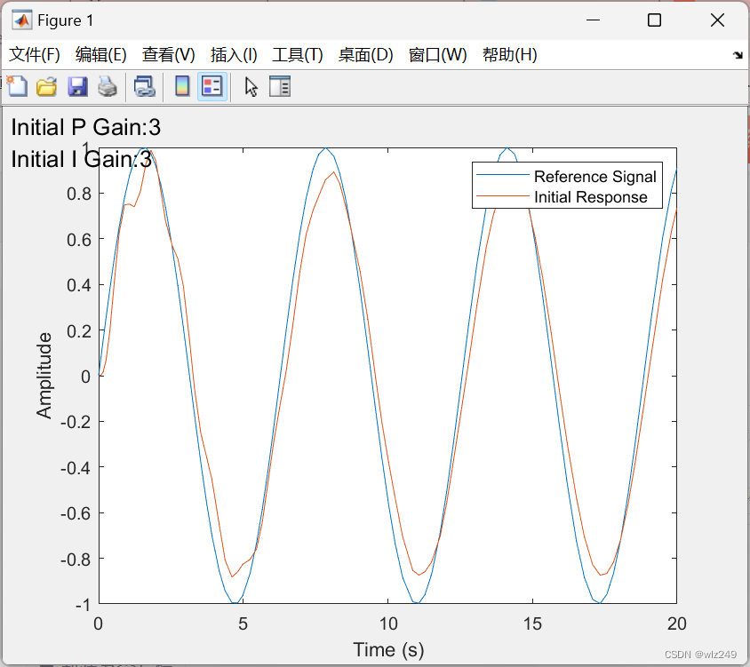
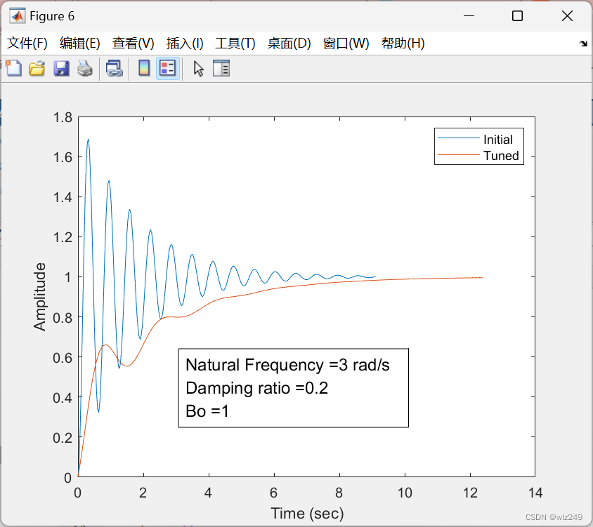
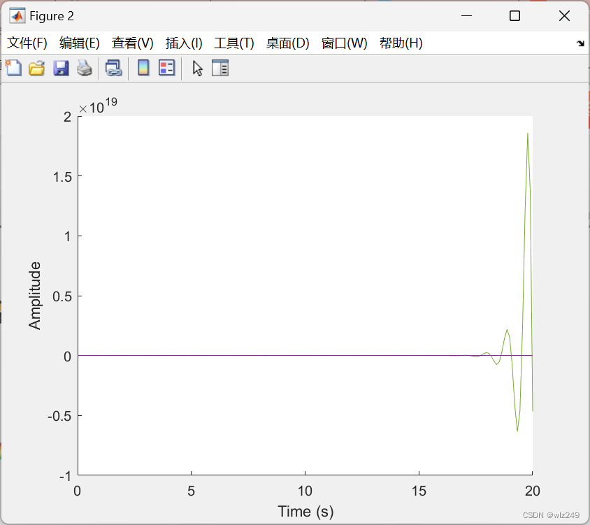
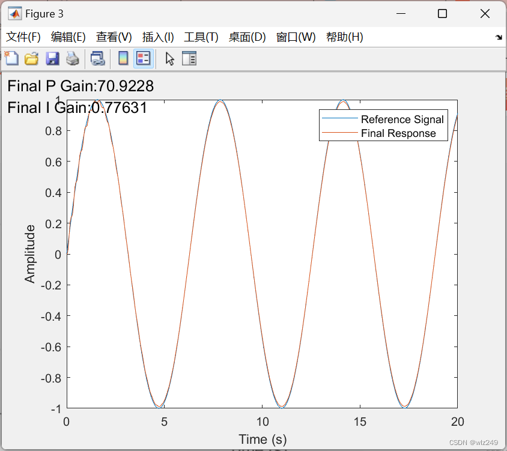
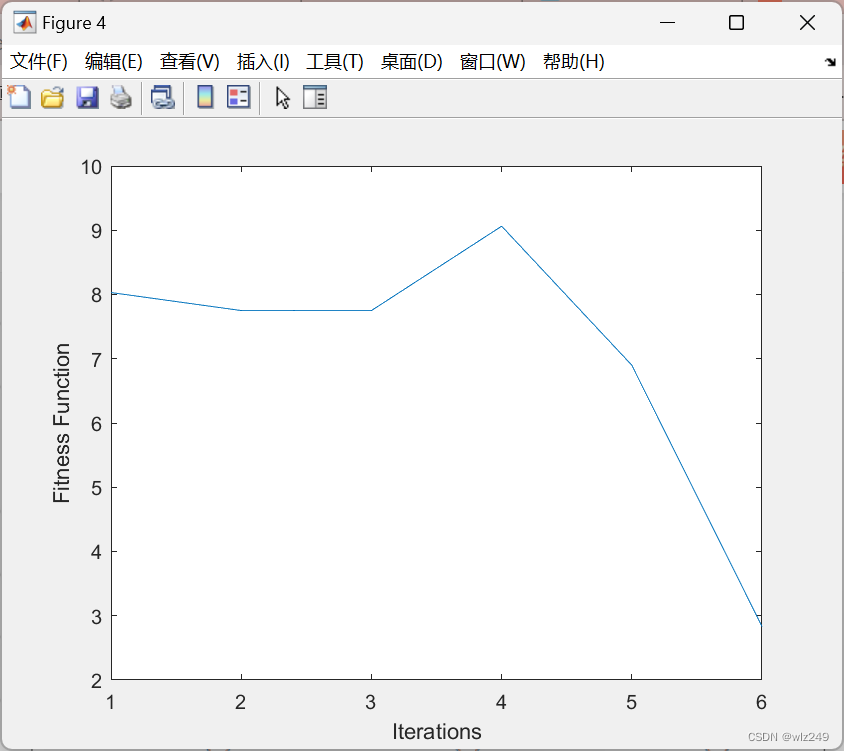
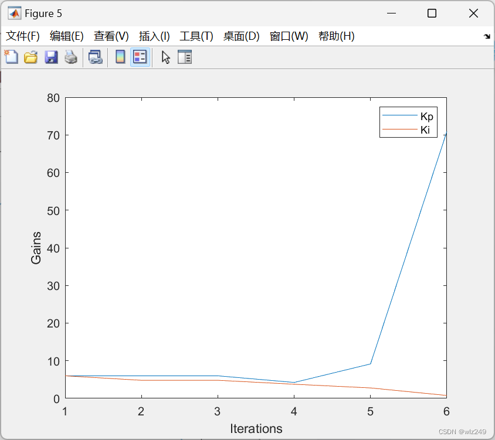

# [Drone] Research on the Implementation of PID Controller Gain Based on Genetic Algorithm

​  
Research on the Implementation of PID Controller Gain Based on Genetic Algorithm - Taking Unmanned Aerial Vehicle (UAV) as an Example
I. Introduction
The PID controller is a common type of automatic controller, playing an important role in the flight attitude and speed control of drones. However, in practical applications, the parameter tuning of the PID controller often involves a complex and time-consuming process. To optimize the parameters of the PID controller, this paper adopts genetic algorithms (GA) for automatic tuning and simulates the dynamics of a second-order system based on satisfaction criteria for tuning.
II. Basic Principles of PID Controller
The PID controller is a type of linear controller that primarily forms the control error based on the given value and the actual output value, then uses this error to provide a reasonable control quantity. The PID controller contains three main parameters: Proportional (P), Integral (I), and Derivative (D).
Proportional control (P): Controls the output value by amplifying errors in proportion, allowing the controlled object to approach the set value more quickly.
Integral control (I): Integrating the error to eliminate static errors in the system.
Differential control (D): Differentiating the error to suppress transient processes in the system.
The formula for calculating the output value of a PID controller is: output = Kp * error + Ki * integral(error) + Kd * derivative(error), where Kp, Ki, and Kd are the proportional, integral, and derivative parameters respectively. error represents the current error value, integral(error) denotes the accumulated error value, and derivative(error) indicates the rate of change of error.
III. Basic Principles of Genetic Algorithms
Genetic algorithm is an optimization algorithm that simulates the natural selection and genetic mechanisms. By simulating the process of selection in biological evolution. Crossover and mutation operations, Search the solution space. Thus, to find the optimal solution or an approximate optimal solution.
In the optimization of PID controller parameters, genetic algorithms take the parameters (Kp, Ki, Kd) of the PID controller as individuals and iteratively search for the optimal parameter combination through operations such as selection, crossover, and mutation.
IV. Genetic Algorithm-Based PID Controller Gain Implementation
Initial population: Randomly generate a certain number of individuals in the solution space to serve as the initial population. Each individual contains three genes: Kp, Ki, and Kd.
Fitness evaluation: Evaluate the fitness of each individual based on satisfaction criteria. The fitness function can be designed based on system output error, stability, and other indicators.
Selection operation: Select individuals with higher fitness as parents to generate new individuals for the next generation.
Crossover operation: Perform crossover operations on parental individuals to produce new offspring. Crossover methods can include single-point crossover or double-point crossover.
Mutation operation: Apply mutation operations on offspring individuals to increase the diversity of the solution space. Mutation methods can include random mutation or uniform mutation.
Iterative search: Repeat the selection, crossover, and mutation operations until an optimal parameter combination is found. During iterations, record the best individual and its fitness value for subsequent analysis.
Verification results: Apply the optimal parameter combination to the drone control system for practical validation. Simulation experiments using a Simulink model can be conducted to evaluate system output error, stability, and other indicators.
Conclusion: This paper uses genetic algorithms to automatically optimize the parameters of the PID controller on drones. By simulating the dynamics of a second-order system and optimizing based on satisfaction criteria, the optimal PID parameter combination was successfully found. Experimental results show that the optimized PID controller significantly improves the control precision and stability of the drone. In the future, further exploration of other optimization algorithms for PID controller parameter tuning can be conducted to enhance the performance of drone control systems.
📈2 Run Results Edit
Edit
Edit
Edit
Edit
Part of the code:

```matlab
clear all; 
clc; 
% Values of damping, natural frequency and SS gain 
damping_ratio = (2:8)/10; 
natural_freq = (3:10); 
b0 = 1; 
%variables used to selected different frequency/damping values 
i = 1; % natural frequency 
j = 1; % damping ratio 
% Calculating the values of the nominator and denominator of the TF 
a = b0*(natural_freq(i)^2); 
b = 2*natural_freq(i)*damping_ratio(j); 
c = natural_freq(i)^2; 
k =1; 
%Simulink model required 
model = 'reference_tracking'; 
load_system(model) 
max_prop_gain = 1; 
max_int_gain = 1; 
% kp_initial = rand*max_prop_gain; 
% ki_initial = rand*max_int_gain; 
kp_initial = 3; 
ki_initial = 3; 
%population creation 
```
gains = [kp_initial ki_initial;
         0.5*kp_initial ki_initial;
         kp_initial 0.5*ki_initial;
         0.5*kp_initial 0.5*ki_initial;
         2*kp_initial 2*ki_initial];
disp(gains);
kp = kp_initial;
ki = ki_initial;
kp_p1 = num2str(kp);
ki_p2 = num2str(ki);
s_kp_p1 = strcat('Initial P Gain: ', kp_p1);
s_ki_p2 = strcat('Initial I Gain: ', ki_p2);
initial_gains = [s_kp_p1 char(10) s_ki_p2]; % textbox element
% References
% Matlab code implementation

## Images








<!-- PAYMENT_BLOCK -->

## Get this dataset

- Payment link (Stripe): [Buy now](https://buy.stripe.com/3cs8yP7sY87d0vu9AB)
- Payment QR code: 

<!-- /PAYMENT_BLOCK -->
